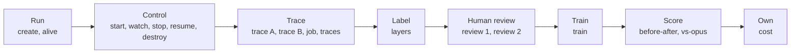

# Demo: the workflow, and what happens behind it

For builders and testers. It lists every demo command in order, what runs behind each one, what you should see, and how to tell whether it worked.

The demo is one script, [`demo/demo.py`](../demo/demo.py). It adds no logic of its own. It calls the real tools or reads saved results, then prints the answer in plain words. No number on screen is typed into the script.

## The workflow



| Part | Commands | Source of the output |
|---|---|---|
| Run, Control | `create`, `alive`, `start`, `agents`, `watch`, `stop B`, `resume B`, `destroy` | Live, on the server |
| Trace | `trace A`, `trace B` | Live, from the trace store |
| Trace | `job`, `traces` | One saved job, the saved batch, and the trace store |
| Label | `layers`, `labels` | Saved labelling run |
| Human review | `review 1`, `review 2` | Saved jobs, processed live by the real label tool |
| Train, Score, Own | `train`, `before-after`, `vs-opus`, `cost` | Saved results |

Nothing in the demo calls a model or needs a GPU.

## Setup

You need a Linux server set up as in the README Quick start (`just push && just spire && just gateway && just image`). Then, on the server:

```bash
cd ~/poc
alias demo='python3 demo/demo.py'
```

Run every command from the repository root. `demo` with no arguments lists the commands. To test beside a running computer, set another slot first, such as `export DEMO_VM=vm-02`.

## What happens behind each command

### 1. Run

**`demo create`** runs `sudo infra/vm create vm-01`.
1. `identity/registrar.py vm-up` gives the new computer its identity through SPIRE, with a short-lived join token.
2. `infra/vm` copies the disk image and sets up a private network device and firewall rules.
3. It starts a Firecracker microVM inside the jailer, then polls `/health` until the computer answers. That time is the "Ready in" figure.
4. `collect/store.py` records a `vm.boot` event.

**See:** `Ready in`, about 3 seconds. The first start after a server boot takes about 6.

**`demo alive`** calls `GET /health` on `infra/agent/agent.py`, the agent inside the computer. **See:** `Answer ALIVE`.

### 2. Control

**`demo start`** calls `POST /spawn` on the computer, which starts the test agent `infra/agent/demo_agent.py`.
1. `agent.py` asks the registrar for an identity for A. The registrar creates a SPIRE entry and records `agent.spawn`.
2. `agent.py` puts A in its own cgroup and starts it with its own user ID.
3. A asks for its helper B over a local socket. The caller is known by its user ID, so B's identity shows that A started it, and B's cgroup sits inside A's.
4. The script saves both identities to `/tmp/avos-demo-vm-01.json`, for `demo trace` to use later.

**See:** two agents running, with identities ending in `/agent/A` and `/agent/A/sub/B`.

**`demo watch`** reads each agent's latest count from the computer's log, for 3 seconds. Each agent counts about 20 times a second, and tries a $1 refund every 10th count. **See:** both numbers rising, both `● working`.

**`demo stop B`** runs `sudo supervisor/ctl.py halt <B's identity>`.
1. `ctl.py` counts the command first, so a stop that left no record would show up.
2. It calls `POST /halt` on the computer, which writes to B's `cgroup.freeze` and waits for `frozen 1`.
3. It records a `halt` event with a receipt, and writes B to `/var/lib/avos/cut.json`, which the gateway checks on every request.

**See:** a receipt, then A rising and `■ stopped` on B.

**`demo resume B`** does the reverse and records a `resume` event. **See:** B carries on from where it stopped.

**`demo destroy`** runs `sudo infra/vm destroy vm-01`. It reads the agents' final counters, stops the microVM, removes the network device and firewall rules, and deletes the computer's files. `identity/registrar.py vm-down` removes its identities and records the exits. The trace store is kept. **See:** `Answer now: nothing. It is gone.`

### 3. Trace

**`demo trace A`, `demo trace B`** run `sudo collect/bin/avos trace --principal <identity>` and group the repeated events. These events were written while the agents ran:

| Line on screen | Event | Written by |
|---|---|---|
| started, ended | `agent.spawn`, `agent.exit` | `identity/registrar.py` |
| tried issue_refund, refused | `authz.decision` | `gateway/gateway.py`, using Cedar policies |
| stopped, resumed | `halt`, `resume` | `supervisor/ctl.py` |

Refunds are refused with `default-deny` because no policy allows these agents to issue them. Events are stored under `/var/lib/avos/trace/vm/<vm_id>/`, one file per writer.

**See:** `stopped` and `resumed` lines for B only, and no refund attempts between them.

**`demo job`** reads one saved job from `train/tests/fixtures/p11/export/trajectories.jsonl`. It shows the customer's request and the tools the agent called. **`demo traces`** counts the computers in the trace store and reads the batch totals from `data/poc12/p11-train-labels-p12/manifest.json`. **See:** 520 jobs, 520 complete, 6,428 training examples.

A and B are test agents. The jobs come from τ²-bench, a public test where an AI plays the customer. They are not real customers.

### 4. Label

**`demo layers`** counts the decisions in the saved labelling run. A job's label comes from the first rule that applies (`label/CONTRACT.md`):

| Layer | Tool | Effect in this batch |
|---|---|---|
| 1. Automatic check | `label run --level 0` | Drops 309 |
| 2. AI judge, asked two ways | `label run --level 1` | Drops 24 |
| 3. Checklist of 7 questions | `label run --checklist` | Advice only, drops 0. Tried on 79 jobs in an earlier batch |
| 4. Human review | `label human` | 60 reviewed. Settled 25: keeps 16, drops 9 |

**See:** 520 in, 178 kept, 342 dropped. In this batch, Claude Opus 5.5 did the review, standing in for a person.

**`demo labels`** adds the judge's consistency, 87%, and its agreement with the review, 0.55.

### 5. Human review

**`demo review 1`** and **`demo review 2`** show one saved job with its score hidden, then ask for `y` or `n`.
1. `label/bin/label human` appends your verdict as a row.
2. `label/bin/label run --level 0` applies the same rules used for the real batch.
3. The script prints the tool's decision.

| Command | The job | Answer | See |
|---|---|---|---|
| `review 1` | The agent changes the address and confirms it | `y` | `KEEP` |
| `review 2` | The customer agrees to a return, but the agent never makes it | `n` | `DROP` |

Both answers go to a practice store, `/tmp/avos-demo-labels`, and `review 1` empties it. The real labels in `/var/lib/avos/labels` do not change.

In these two jobs the automatic check agrees with the reviewer. A human verdict decides only where the automatic check passed or the test is known to be uninformative. On a job that failed the check, it is recorded but the job stays dropped.

### 6. Train, Score, Own

| Command | Reads | See |
|---|---|---|
| `demo train` | `data/poc12/fit-gate/fit.json` | 265 good jobs, 4.25 hours, $7.91 |
| `demo before-after` | `fleet compare` on `data/poc11/p11-heldout` and `data/poc12/p12-heldout` | 41% to 51%, +10 points, range +3 to +16 |
| `demo vs-opus` | `fleet compare` on `data/poc13/p13-heldout-opus` and `p13-heldout-retrained` | 48% and 47%, too close to call |
| `demo cost` | `data/poc13/m15-pooled.json` | 18 times cheaper: passed. Score against Opus 96%, range 55% to 163%: not yet established |

The score of the retrained model is not a proven gain. Across repeated sessions the training gain shrinks to about 4 points, which is too small to be sure of. See [`data/poc12/README.md`](../data/poc12/README.md) and [`data/poc13/README.md`](../data/poc13/README.md).

## How the saved results were made

The demo replays the output of this pipeline. It does not run it. Full commands and settings are in [`docs/reproduce.md`](reproduce.md) section 7.

| Step | Script | Produces |
|---|---|---|
| 1. Run jobs in microVMs | `fleet/bin/fleet run` | Trace events, one result per job |
| 2. Turn traces into training items | `retrain/bin/retrain export` | `trajectories.jsonl` |
| 3. Label the jobs | `label/bin/label run`, `label human` | Labels and a list of kept jobs |
| 4. Select the kept jobs | `train/bin/train select` | Training data |
| 5. Train and merge | `train/bin/train fit`, `merge` | The retrained model |
| 6. Test on unseen tasks | `fleet/bin/fleet run --part held_out` | Results per session |
| 7. Score | `fleet/bin/fleet matrix`, `compare`, `m15` | The numbers shown in the demo |

## Tester checklist

Run the commands in order. Each should pass without a Python error.

- [ ] `demo create`: `Ready in` is under 10 seconds.
- [ ] `demo alive`: `Answer ALIVE`.
- [ ] `demo start`: two identities are listed, and B's starts with A's.
- [ ] `demo watch`: both counts rise.
- [ ] `demo stop B`: a receipt appears, B stays still, and A rises.
- [ ] `demo resume B`: B rises again, from where it stopped.
- [ ] `demo destroy`: `nothing. It is gone.`
- [ ] `demo trace A`: no `stopped` line.
- [ ] `demo trace B`: `stopped` and `resumed` lines, with the same receipts as `stop` and `resume`.
- [ ] `demo job`, `demo traces`, `demo layers`: the numbers match this document.
- [ ] `demo review 1`, answer `y`: `KEEP`.
- [ ] `demo review 2`, answer `n`: `DROP`.
- [ ] Line counts in `/var/lib/avos/labels` are the same before and after the reviews.
- [ ] `demo train`, `demo before-after`, `demo vs-opus`, `demo cost`: the numbers match this document.

The computer ID in each identity changes on every run. `demo traces` counts every computer ever recorded on the server, so that number differs between servers.

## If something fails

| You see | Cause | Fix |
|---|---|---|
| `vm-01 exists; run: vm destroy vm-01` | A computer is left over | `demo destroy`, then `demo create` |
| `Agent B is not running` | Agents were not started, or the computer is gone. Agents exit by themselves after 30 minutes | `demo start` |
| `No trace of agent A yet` | `demo start` has not run for this slot | `demo create`, then `demo start` |
| `fleet: matrix A unreadable` or a missing `data/` file | The server has an older copy of `data/` | Run `just push` again |
| `missing /var/lib/avos/agent.env` | The server is not set up | Follow the README Quick start |
